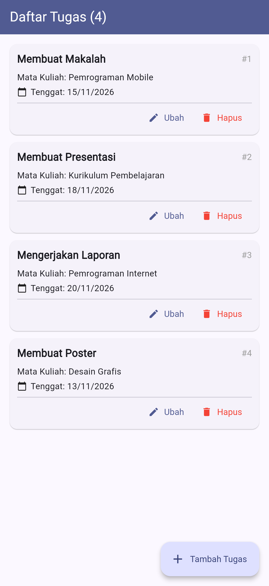
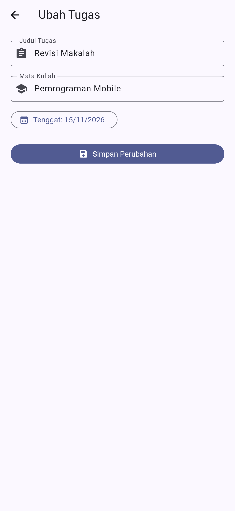
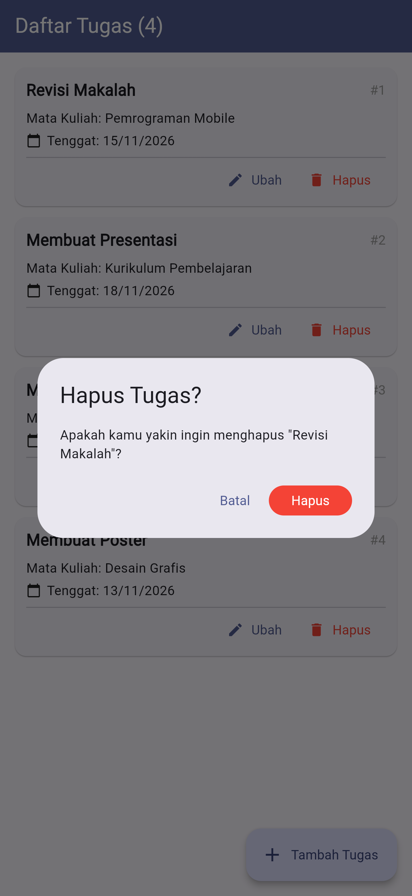
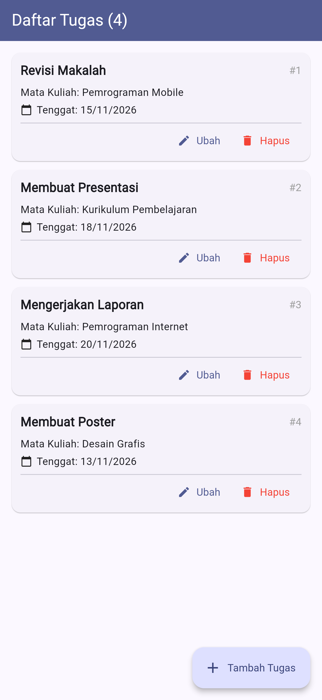

# Daftar Tugas Kuliah

Aplikasi Flutter untuk mencatat tugas kuliah dengan operasi **CRUD** lengkap (Create, Read, Update, Delete). Dibuat sebagai Tugas Mandiri Sesi-7 mata kuliah Pemrograman Mobile.

## Fitur

| Operasi | Keterangan |
|---|---|
| **Create** | Tambah tugas melalui formulir dengan validasi |
| **Read** | Daftar tugas dengan `ListView.builder`, jumlah tugas di AppBar, dan pesan khusus saat daftar kosong |
| **Update** | Tombol **Ubah** membuka formulir yang sudah terisi data sebelumnya. Data dicari berdasarkan `id`, bukan indeks List |
| **Delete** | Tombol **Hapus** menampilkan `AlertDialog` konfirmasi (Batal / Hapus) |
| **Umpan balik** | `SnackBar` muncul setelah tambah, ubah, dan hapus berhasil |

### Validasi formulir
- Judul wajib diisi, minimal 3 karakter
- Mata kuliah wajib diisi
- Tenggat waktu wajib dipilih

## Model Data

```dart
class Tugas {
  final int id;          // identitas unik, bertambah otomatis
  final String judul;
  final String mataKuliah;
  final DateTime tenggat;
}
```

## Tangkapan Layar

| Daftar tugas | Formulir ubah | Dialog hapus | Setelah diubah |
|---|---|---|---|
|  |  |  |  |

Tangkapan layar lainnya: [daftar awal](screenshots/01-daftar-awal.png), [formulir tambah](screenshots/02-form-tambah.png), [setelah dihapus](screenshots/07-setelah-dihapus.png).

## Teknologi
- Flutter (Material 3)
- Penyimpanan sementara dalam `List` (tanpa database, REST API, atau package tambahan)
- `setState()` untuk memperbarui tampilan

## Cara Menjalankan

1. Pastikan [Flutter SDK](https://docs.flutter.dev/get-started/install) sudah terpasang, lalu cek dengan `flutter doctor`.
2. Clone repositori ini:
   ```bash
   git clone https://github.com/USERNAME/daftar-tugas-kuliah.git
   cd daftar-tugas-kuliah
   ```
3. Unduh dependensi:
   ```bash
   flutter pub get
   ```
4. Jalankan aplikasi:
   ```bash
   flutter run
   ```

## Struktur Kode

Seluruh kode berada di `lib/main.dart`:

- `Tugas`: model data
- `MyApp`: konfigurasi aplikasi dan tema
- `HalamanDaftar`: menampilkan daftar, serta menangani tambah, ubah, dan hapus
- `HalamanForm`: formulir untuk mode tambah dan mode ubah

## Identitas

- **Nama:** [ISI NAMA LENGKAP]
- **NIM:** [ISI NIM]
- **Kelas:** [ISI KELAS]
